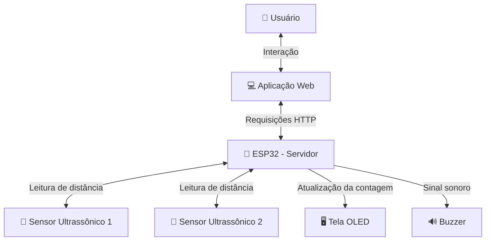
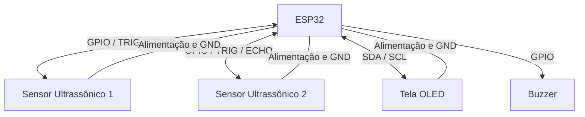

# 🐄 PassBy — Sistema Inteligente de Contagem de Animais

<p align="center">
  
  
  
  
</p>

<p align="center">
  <b>Automatizando a contagem de animais e tornando o controle do rebanho mais eficiente.</b>
</p>

---

## 📌 1. Sobre o Projeto

O **PassBy** é um sistema ciberfísico desenvolvido utilizando o microcontrolador ESP32, sensores ultrassônicos e atuadores, com o objetivo de automatizar a contagem de animais durante sua passagem por um determinado espaço, como a entrada de um curral.

### 🎯 Problema Identificado

Atualmente, muitos produtores rurais realizam a contagem de animais manualmente, principalmente durante a entrada e movimentação dos animais nos currais.

Esse processo está sujeito a falhas humanas, como:
- Contagens incorretas;
- Esquecimento de animais;
- Divergências nos registros;
- Dificuldade no acompanhamento do rebanho.

Esses problemas podem comprometer o controle dos animais e dificultar o gerenciamento das atividades da propriedade rural.

### 💡 Nossa Solução

O PassBy propõe uma solução automatizada capaz de identificar a passagem dos animais utilizando **dois sensores ultrassônicos**, realizar a contagem por meio de um microcontrolador ESP32 e disponibilizar os dados em uma plataforma web.

O sistema também conta com uma tela OLED para exibição de informações e um buzzer para sinalização sonora.

Dessa forma, o projeto busca proporcionar maior precisão, praticidade e eficiência no controle de entrada e movimentação dos animais.

---

## 👥 2. Integrantes da Equipe

| Integrante | Registro Acadêmico (RA) |
|:---|:---:|
| Luma Lima | 40125935 |
| Pedro Henrique Andrade | 40134298 |
| Pedro Iago Duarte de Moraes | 40135302 |
| Rayka Souza | 40126497 |
| Victor Souza | 40108564 |

---

## 🏗️ 3. Arquitetura da Solução

A arquitetura do PassBy é composta por uma aplicação cliente (plataforma web), um servidor hospedado no ESP32, sensores ultrassônicos e atuadores.

O ESP32 é responsável por receber os dados dos sensores, processar a passagem dos animais, atualizar a contagem e controlar os dispositivos conectados.

A aplicação cliente realiza a comunicação com o microcontrolador por meio do protocolo HTTP, permitindo consultar as informações disponibilizadas pelo sistema.

### Diagrama de Arquitetura



### Fluxo de Funcionamento

1. Os sensores ultrassônicos identificam a aproximação e a passagem dos animais.
2. O ESP32 recebe e processa as informações dos sensores.
3. O microcontrolador realiza a contagem dos animais identificados.
4. A tela OLED apresenta as informações do sistema.
5. O buzzer realiza a sinalização sonora.
6. A aplicação web consulta os dados disponibilizados pelo servidor ESP32.

---

## 🔌 4. Hardware Utilizado

O projeto utiliza componentes eletrônicos responsáveis pela identificação da passagem dos animais, processamento das informações e apresentação dos resultados.

### Lista de Componentes

| Componente | Quantidade | Função |
|:---|:---:|:---|
| ESP32 | 1 | Microcontrolador principal e servidor HTTP |
| Sensor ultrassônico | 2 | Identificação da passagem dos animais |
| Tela OLED | 1 | Exibição das informações e da contagem |
| Buzzer | 1 | Sinalização sonora |
| Protoboard | 1 | Montagem do circuito eletrônico |
| Jumpers | Conforme necessário | Realização das conexões elétricas |

### Imagens dos Componentes

**Microcontrolador ESP32**


**Sensores ultrassônicos**


**Tela OLED**


**Buzzer**


**Protoboard**


### Esquemático do Circuito

> Inserir aqui a imagem do esquemático elétrico completo, demonstrando as conexões entre o ESP32, os dois sensores ultrassônicos, a tela OLED e o buzzer.

### Diagrama de Conexões



### Tabela de Pinagem

| Componente | Pino do Componente | Pino ESP32 |
|:---|:---:|:---:|
| Sensor ultrassônico 1 | TRIG | D5 |
| Sensor ultrassônico 1 | ECHO | D18 |
| Sensor ultrassônico 2 | TRIG | D19 |
| Sensor ultrassônico 2 | ECHO | D25 |
| Tela OLED | SDA | D21 |
| Tela OLED | SCL | D22 |
| Buzzer | Sinal | D23 |
| Todos os componentes | GND | GND |

---

## 🌐 5. Documentação da API e Comunicação

O PassBy utiliza o protocolo **HTTP** para estabelecer a comunicação entre a aplicação web e o servidor hospedado no ESP32.

Essa comunicação permite que o cliente consulte informações do sistema e envie comandos para o controle dos atuadores.

### Informações de Comunicação

| Configuração | Descrição |
|:---|:---|
| Protocolo | HTTP |
| Servidor | ESP32 |
| Cliente | Aplicação Web |
| Endereço IP | IP disponibilizado pelo ESP32 |
| Porta | A confirmar |
| Formato dos dados | A confirmar |

### Endpoints

Os seguintes endpoints representam a estrutura documentada inicialmente para o projeto. Sua implementação deve ser conferida no código-fonte do servidor.

| Método | Endpoint | Descrição |
|:---:|:---|:---|
| GET | `/status` | Consulta o status do sistema |
| GET | `/sensor` | Consulta os dados dos sensores |
| POST | `/controle` | Envia comandos aos atuadores |

### Exemplos de Requisições

**Consultar status do sistema**

```http
GET /status HTTP/1.1
Host: IP_DO_ESP32
```

**Consultar dados dos sensores**

```http
GET /sensor HTTP/1.1
Host: IP_DO_ESP32
```

**Enviar comando para os atuadores**

```http
POST /controle HTTP/1.1
Host: IP_DO_ESP32
Content-Type: application/json

{
  "estado": "ligado"
}
```
---

## ⚙️ 6. Instalação e Execução

### 📋 Pré-requisitos

Antes de executar o projeto, é necessário possuir:

- Arduino IDE instalado;
- Suporte à placa ESP32 configurado;
- Cabo USB para conexão com o microcontrolador;
- Drivers necessários para reconhecimento da placa;
- Navegador web atualizado;
- Rede Wi-Fi disponível;
- Bibliotecas necessárias para os sensores, tela OLED e demais componentes.

### 6.1. Configuração do ESP32

**1. Instalar a Arduino IDE**

Faça o download pelo site oficial:

https://www.arduino.cc/en/software

**2. Configurar o suporte ESP32**

Instale o pacote de placas ESP32 pelo Gerenciador de Placas da Arduino IDE.

**3. Abrir o firmware**

Acesse o seguinte arquivo:

```text
src/esp32/esp32_server.ino
```

**4. Configurar as credenciais Wi-Fi**

Insira as informações da rede utilizada no código:

```cpp
const char* ssid = "NOME_DA_REDE";
const char* password = "SENHA_DA_REDE";
```

**5. Conectar e configurar a placa**

- Conecte o ESP32 ao computador via USB.
- Selecione o modelo correto da placa.
- Selecione a porta COM correspondente.

**6. Compilar e carregar**

- Clique em verificar para compilar o firmware.
- Confira se não existem erros.
- Clique em carregar para enviar o código ao ESP32.
- Abra o Monitor Serial para acompanhar a inicialização e verificar o endereço IP disponibilizado.

### 6.2. Executar a Aplicação Cliente

**1. Acessar a pasta do cliente**

```bash
cd src/client
```

**2. Abrir a aplicação**

Localize o arquivo:

```text
index.html
```

Abra-o em um navegador web.

**3. Configurar a comunicação**

Certifique-se de que:

- O ESP32 esteja ligado e conectado à rede Wi-Fi.
- O computador ou dispositivo cliente esteja conectado à mesma rede.
- O endereço IP do ESP32 esteja configurado corretamente na aplicação, caso necessário.

**4. Testar o sistema**

Após a inicialização, verifique se a aplicação consegue consultar os dados dos sensores e se as funcionalidades de controle estão respondendo corretamente.

---

## 🎥 7. Demonstração do Projeto

O vídeo demonstrativo apresenta o funcionamento do PassBy, mostrando a montagem física, a identificação da passagem dos animais, a atualização da contagem e a comunicação com a aplicação web.

**Fotos do projeto:**
<p align="center">
  
  
  
</p>

**Vídeo de demonstração:**


https://github.com/user-attachments/assets/afe567fe-53b1-4bf1-90e3-e1d9043a39f4


---

## 💻 8. Tecnologias Utilizadas

| Tecnologia | Aplicação |
|:---|:---|
| ESP32 | Microcontrolador e servidor |
| C/C++ | Desenvolvimento do firmware |
| Arduino IDE | Compilação e envio do código |
| HTML | Estrutura da aplicação web |
| JavaScript | Lógica e comunicação do cliente |
| HTTP | Comunicação entre cliente e servidor |
| Sensores ultrassônicos | Identificação de passagem |
| OLED | Exibição de informações |

---

## 🤝 9. Histórico de Desenvolvimento

O desenvolvimento do PassBy foi realizado de maneira colaborativa, com a participação dos integrantes da equipe nas etapas de planejamento, implementação, integração de hardware e software e testes.

O histórico de desenvolvimento pode ser acompanhado diretamente pelo repositório GitHub, por meio dos commits individuais realizados pelos integrantes.

---

<p align="center">
  <b>🐄 PassBy — Tecnologia a favor da inovação no campo.</b>
  <br/>
  <sub>Projeto acadêmico de Sistemas Ciberfísicos — 2026</sub>
</p>
